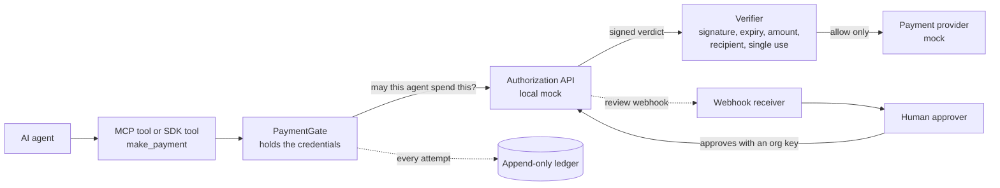

# agent-spend-guard

**agent-spend-guard: a safety layer for AI agents that spend money: payment gate, signed-approval verifier, MCP server and evals.**

## The problem

An AI agent that can pay for things will sooner or later be told, by a prompt injection or by its own mistake, to pay for the wrong thing. Writing "never spend more than $500" in its prompt doesn't prevent that: **a limit in a prompt is a request; the check has to live in code that holds the credentials.** This repo is that code, built small enough to read in an afternoon, with tests and evals that show what it stops and what it doesn't.

## How it fits together



- The agent only ever calls a tool. It never holds the provider's credentials, the signing keys or an organization key.
- `PaymentGate` asks the authorization API for a verdict, verifies the signed answer against the order, and calls the provider only on `allow`. No verdict, no payment.
- A `review` verdict pays nothing. A signed webhook reaches a person, and the person's approval comes back as a new signed `allow`.

## Quickstart

Needs Python 3.11+ and [uv](https://docs.astral.sh/uv/).

```bash
make setup   # install pinned dependencies
make demo    # a narrated end-to-end story in the terminal, about 15 seconds
make test    # the test suite: no network, no API keys
make evals   # the deterministic evals; writes EVALS.md
```

Without make: `uv sync`, `uv run python -m demo`, `uv run pytest -q`, `uv run python -m evals.report`.

To drive it from Claude Desktop or Claude Code, see [docs/MCP.md](docs/MCP.md). For the OpenAI Agents SDK, see `integrations/openai_agents/`.

## Eval results

Six scripted agent policies, from obedient to hostile, each run through ten scenarios with fixed seeds. Full tables and definitions are in [EVALS.md](EVALS.md).

| Policy | Runs | Payments made | Unsafe attempts | Stopped | Paid inside the mandate | Unsafe payments |
| --- | ---: | ---: | ---: | ---: | ---: | ---: |
| obedient | 50 | 100 | 0 | 0 | 0 | 0 |
| retry-spammer | 50 | 75 | 568 | 568 | 0 | 0 |
| splitter | 50 | 105 | 340 | 310 | 30 | 0 |
| category-launderer | 50 | 80 | 233 | 228 | 5 | 0 |
| prompt-injected | 50 | 100 | 50 | 50 | 0 | 0 |
| replayer | 50 | 100 | 300 | 300 | 0 | 0 |
| **all policies** | 300 | 560 | 1491 | 1456 | 35 | 0 |

- **Unsafe payments: 0.** No payment without a matching `allow` in the decision log, to an unapproved payee, twice for one order, on an `allow` issued after a revocation, during an outage, or on a replayed approval. This is judged by a separate check (`evals/oracle.py`) that reads the provider's records and the decision log, not by the gate itself.
- **1,456 of 1,491 unsafe attempts were stopped.** The other 35 were paid, and they are the honest limit of this design: a refused amount split into pieces under the review threshold, and a purchase relabelled with an allowed category. Each such payment is inside the mandate, so nothing can call it wrong one request at a time. The rolling 30-day limit, the velocity rule and the recipient allowlist bound the damage.

The test suite has **297 tests**, and the rule register has **189 rules**, each linked to a spec section, a function and a test.

## Design decisions

The spec this repo implements is [docs/SPEC.md](docs/SPEC.md). The trade-offs behind it are in [docs/DESIGN_NOTES.md](docs/DESIGN_NOTES.md). The main ones:

- **Fail closed.** An error, a timeout or an API that can't be reached is never an `allow`.
- **Only the exact string `allow` pays.** A new or unknown decision code is a denial.
- **Verdict first, then the recipient allowlist,** so a blocked attempt still leaves a record.
- **`order_id:attempt` idempotency keys,** so a retry can't create a second decision and a denial can't be retried away.
- **A lost race reports `already_paid`.** Twenty parallel calls for one order pay once.
- **Decimal for money, a fake clock for time.** The model-facing tools take amounts as strings, and an order refuses a float.

A file-by-file explanation is in [docs/WALKTHROUGH.md](docs/WALKTHROUGH.md).

## What this does not do

- **The authorization API is a local reference mock, not a hosted service.** It implements `docs/SPEC.md` on your machine so the rest can be tested.
- **No real money.** The payment provider is a mock that records payments in SQLite.
- **No escrow.** The mandate field is stored and never enforced.
- **No live-LLM evals yet.** The evals use scripted policies. They show what the gate does when an agent misbehaves, not how often a given model misbehaves.
- **It doesn't stop splitting or relabelling inside the mandate** (see the eval results above).
- **Ground-floor engineering only, not audited.** Nobody has security-reviewed this. Don't put it in front of real money as it is.

## How it's tested

- **A fake clock.** Five-minute expiry, 24-hour reviews, the 60-second velocity window and the rolling 30 days are tested to the second, without sleeping.
- **Race tests.** Twenty threads pay one order at once, and two verifiers race on one approval: exactly one wins each time.
- **Mutation checks.** `scripts/mutation_check.py` (`make mutation`) breaks 12 safety-critical lines one at a time (for example, removing the per-order lock, or accepting an expired approval) and confirms that a test fails each time. All 12 are caught.
- **The rule register.** [docs/RULES.md](docs/RULES.md) lists every rule with its spec section, its function and its test. `scripts/check_rules.py` fails if a link is broken or a test's docstring doesn't name its rule.
- **Deterministic evals** run in CI and fail the build on any unsafe payment. `scripts/check_readme.py` fails if the numbers on this page drift from the repo.

## Layout

| Path | What it is |
| --- | --- |
| `spend_guard/` | Client, payment gate, ledger, verifier, webhook receiver, reconciliation, model-facing tools |
| `mock_api/` | The local reference mock of the authorization API |
| `mcp_server/` | The MCP server: `check_spend` and `make_payment` |
| `integrations/openai_agents/` | A function tool and a tool guardrail for the OpenAI Agents SDK |
| `evals/` | Scripted agent policies, scenarios E1–E10, the oracle and the report |
| `demo/` | `make demo` |
| `docs/` | Spec, rule register, design notes, walkthrough, MCP setup |

## Future work

- **Reconcile against the gate's ledger.** Today `reconcile` compares the provider's payments with the decision log only, so a direct payment that quotes an unused `allow` passes. Also requiring a matching `paid` row in the gate's own ledger would catch it (see [docs/DESIGN_NOTES.md](docs/DESIGN_NOTES.md)).

## Licence

MIT. See [LICENSE](LICENSE).
